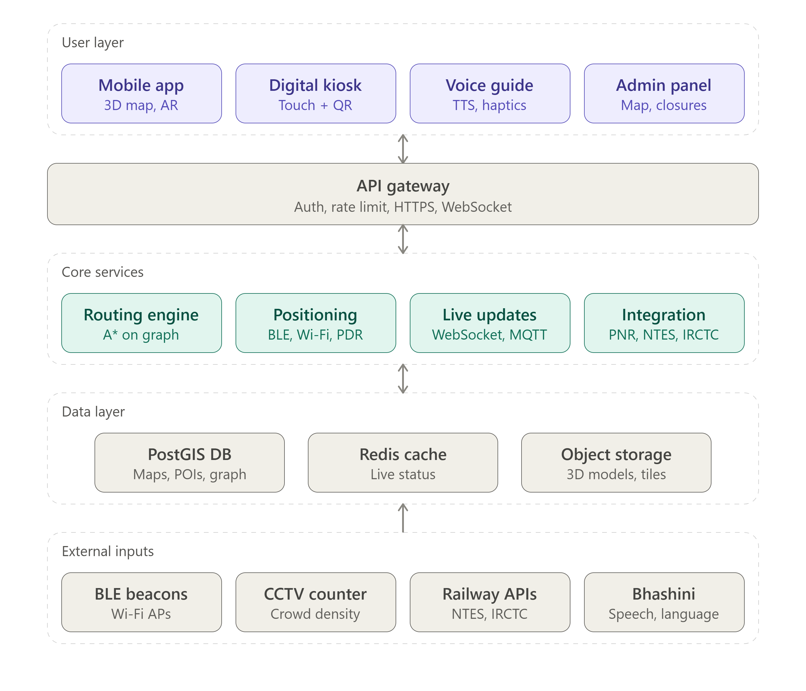
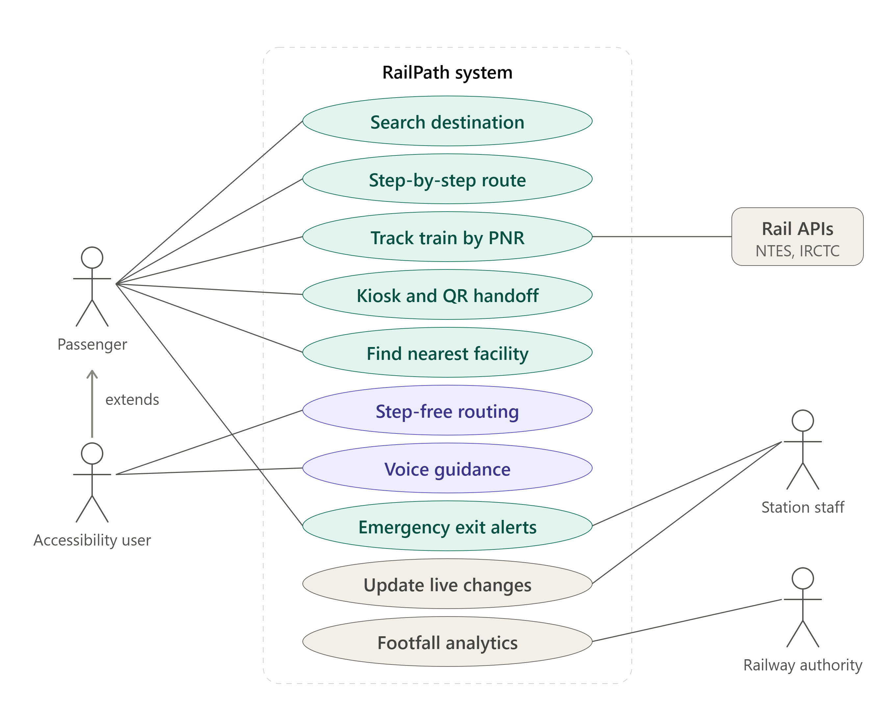

# Smart India Hackathon Workshop
# Date: 27/10/2026
## Register Number: 212225040020
## Name: Aniruth S
## Problem Title
SIH 1710: Enhancing Navigation for Railway Station Facilities and Locations
## Problem Description
Background: Railway stations are complex environments with numerous facilities and locations such as ticket counters, platforms, restrooms, food courts, and waiting areas. Passengers often face difficulties in navigating these spaces, especially in large or unfamiliar stations. Efficient and user-friendly navigation systems are crucial for improving passenger experience, reducing congestion, and ensuring timely travel connections. Description: The problem involves developing a comprehensive navigation solution for railway stations that assists passengers in locating various facilities and destinations within the station premises. This includes creating detailed maps, providing real-time directions, and integrating features such as accessibility options for individuals with disabilities. The solution should be intuitive, easy to use, and accessible via multiple platforms, including mobile devices and digital kiosks. Key challenges include updating navigation information in real-time, ensuring accuracy, and accommodating the diverse needs of all passengers. Expected Solution: The expected solution is a multi-platform navigation system that provides detailed, real-time directions to all facilities and locations within a railway station. This system should include: A mobile application with 3D interactive maps and step-by-step navigation. Digital kiosks located throughout the station with touch-screen interfaces. Voice-guided navigation for visually impaired passengers. Regular updates to reflect changes in station layout and facility locations. Integration with existing railway apps and services for seamless user experience. The solution should enhance the overall passenger experience by reducing confusion, saving time, and improving accessibility within the station.

## Problem Creater's Organization
Ministry of Railway

## Proposed name: RailPath (indoor navigation for railway stations)

## Idea
A multi-platform indoor navigation system that guides passengers inside a station: from entrance to ticket counter, platform, restroom, food court, waiting room, or exit. It covers every place where GPS fails (underground, covered halls, multi-level foot-over-bridges).

**Core idea in one line:** One station map and routing engine, served through a mobile app, digital kiosks, and voice guidance, and kept current by a station admin dashboard.

**What makes it stand out:**

Train-aware routing. Enter a PNR or train number and the app auto-routes you to the correct platform and coach position, and updates if the platform changes.
Accessibility first. Wheelchair-friendly routes (ramps and lifts, no stairs), voice and haptic guidance, high-contrast mode, multilingual support (Hindi, English, and regional languages).
Offline-capable. Station maps are cached, so navigation works with poor network connectivity.
Crowd-aware. Routes avoid congested areas using real-time crowd density.
Live updates. Station staff update closures, platform changes, and temporary facility shifts from an admin panel, and the change reflects instantly for all users.
Kiosk-to-phone handoff. A kiosk shows a QR code, and scanning it sends the route to your phone.

## Proposed Solution / Architecture Diagram

**Working Flow**

**Map creation** - Station floor plans are digitised into a navigation graph (nodes = junctions, doors, stairs, lifts; edges = walkable paths with distance and accessibility flags). POIs are tagged (platform, restroom, ATM, and so on).
**Positioning** - The phone’s location is estimated indoors using BLE beacons plus Wi-Fi fingerprinting, plus phone sensors (accelerometer, gyroscope, compass) for pedestrian dead reckoning. Fusion filtering (Kalman or particle filter) smooths the result. Kiosks have a fixed known location.
**Routing** - The user picks a destination (or enters a PNR). The engine runs A* on the graph with filters (accessible only, fastest, least crowded).
**Guidance** - The route is shown on a 2D/3D map with step-by-step instructions, and spoken by TTS for visually impaired users, with vibration cues on turns.
**Real-time updates** - Admin changes (platform change, lift out of service) or crowd data update edge weights, and active routes are recalculated and pushed via WebSocket.
**Integration** - The Integration Service fetches PNR and train status, so the app suggests “Your train 12345 is on Platform 4, 6 min walk.”

## Use Cases

| #  | Actor                                 | Use Case                                                                                             |
|----|---------------------------------------|------------------------------------------------------------------------------------------------------|
| 1  | First-time passenger                  | Search "Platform 5" or "Ticket counter" and get step-by-step directions.                             |
| 2  | Passenger with a ticket               | Enter PNR, get the platform, route, and coach position, with automatic rerouting on platform change. |
| 3  | Wheelchair user / elderly             | Get step-free routes via ramps and lifts, plus nearest accessible restroom and help desk.            |
| 4  | Visually impaired passenger           | Voice-guided navigation, audio cues, haptic feedback, and screen-reader support.                     |
| 5  | Kiosk user (no smartphone)            | Use the touch kiosk to see the map and route, and scan the QR code to carry it to a phone.           |
| 6  | Passenger in a hurry                  | "Fastest route" mode with an ETA to the platform, avoiding crowded paths.                            |
| 7  | Facility finder                       | Find the nearest restroom, drinking water, food court, waiting room, ATM, or cloakroom.              |
| 8  | Station staff                         | Update closures, platform changes, and temporary diversions from the admin dashboard.                |
| 9  | Emergency                             | Show the nearest exits and evacuation routes and broadcast alerts.                                   |
| 10 | Foreign / regional-language traveller | Multilingual interface and voice.                                                                    |
| 11 | Railway authority                     | Analytics on footfall heatmaps, popular destinations, and bottlenecks for planning.                  |

## Technology Stack
| Layer                 | Technologies                                                                                                         |
|-----------------------|----------------------------------------------------------------------------------------------------------------------|
| Mobile App            | Flutter or React Native (cross-platform); Mapbox GL / Unity or Three.js for 3D; ARCore/ARKit (optional AR arrows)    |
| Kiosk UI              | React.js (PWA) in kiosk mode on touchscreen (Android/Linux)                                                          |
| Admin Dashboard       | React.js + Leaflet/Mapbox indoor editor                                                                              |
| Backend               | Node.js (Express/NestJS) or Python (FastAPI)                                                                         |
| Routing Engine        | A*/Dijkstra on a graph (NetworkX, pgRouting, or custom)                                                              |
| Database              | PostgreSQL + PostGIS; Redis (caching, live state)                                                                    |
| Real-time             | WebSocket / Socket.IO, MQTT, Firebase Cloud Messaging for push                                                       |
| Indoor Positioning    | BLE beacons (iBeacon/Eddystone), Wi-Fi RTT/fingerprinting, sensor fusion (Kalman filter)                             |
| Voice / Accessibility | Android TTS / iOS AVSpeech, Google Speech-to-Text, TalkBack/VoiceOver compatibility, Bhashini API (Indian languages) |
| Crowd Analytics       | OpenCV / YOLO on CCTV feeds (count only, privacy-preserving)                                                         |
| Map Data              | OpenStreetMap indoor tagging, GeoJSON, IMDF, Blender/SketchUp to glTF for 3D models                                  |
| Offline Support       | SQLite / Room, cached map tiles, service workers                                                                     |
| DevOps / Hosting      | Docker, Kubernetes, GitHub Actions CI/CD, AWS/Azure/GCP or NIC/MeghRaj cloud                                         |
| Security              | JWT/OAuth2, HTTPS/TLS, role-based admin access, data anonymisation                                                   |

## Dependencies
**Data dependencies**

Accurate station floor plans/CAD drawings from Indian Railways (per station)
POI data (facilities, platforms, coach position info)
Real-time train data: NTES / IRCTC / RailMadad APIs (PNR status, platform, delays)

**Hardware dependencies**

BLE beacons or Wi-Fi access points installed across the station
Touchscreen kiosks with network connectivity and power
Optional: CCTV cameras for crowd density, speakers for audio guidance

**Software / service dependencies**

Map SDKs (Mapbox / OpenStreetMap), cloud hosting, push notification service
TTS/STT and translation services (Bhashini / Google)
Integration with existing apps (IRCTC Rail Connect, UTS, RailMadad) via APIs/SDKs

**Organisational dependencies**

Station administration to maintain and update map data
Permission from the Railways for API access and hardware installation
Staff training for the admin dashboard

**Suggested Implementation Phases**

**Phase 1 (pilot):** Digitise one station, build the routing engine, mobile app, and kiosk.
**Phase 2:** Add voice guidance, accessibility routing, and PNR integration.
**Phase 3:** Crowd-aware routing, admin analytics, and scale to more stations.